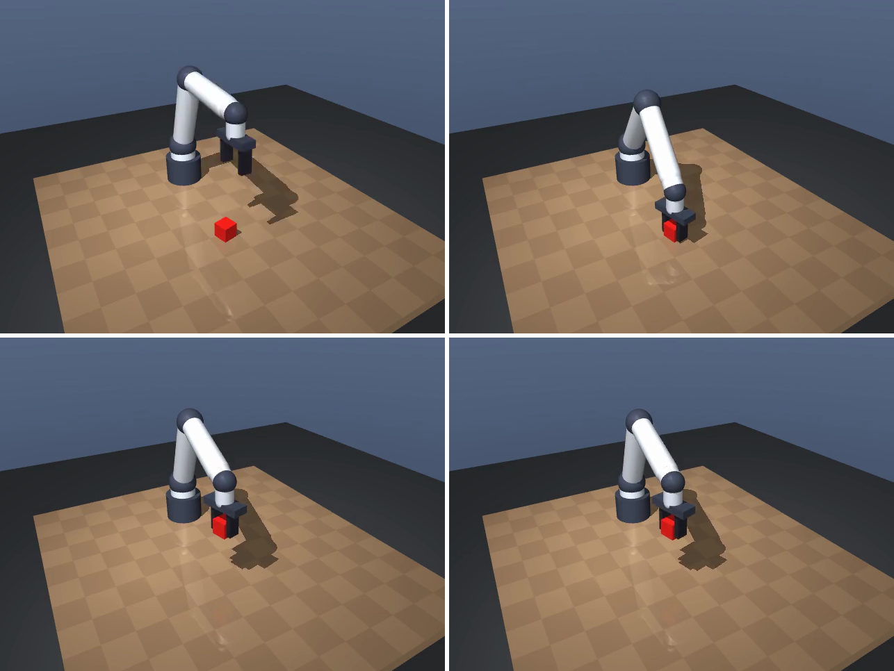
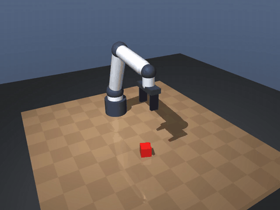
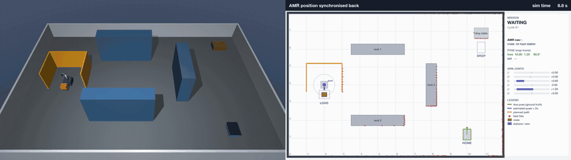

# Robot

Minimal Docker-first integration scaffold for NVIDIA Isaac GR00T N1.7. The repository currently has no robot embodiment or hardware implementation, so this first integration safely verifies connectivity to GR00T's official ZeroMQ `PolicyServer` without sending observations or actuator commands.

## What Runs Where

| Environment | Supported work |
| --- | --- |
| Apple Silicon Mac | Edit configuration, build and run the CPU-only client container, inspect assets/results, and connect to a remote policy server |
| Linux + NVIDIA GPU | Run Isaac GR00T inference/fine-tuning, Isaac Lab training, Isaac Sim, and later robot deployment |

Docker provides the project environment; no host Python virtual environment is required.

## Local Setup

Requirements:

- Docker Desktop with Linux containers
- A reachable GR00T N1.7 policy server for the live connectivity check

Create local configuration:

```bash
cp .env.example .env
```

Build the deterministic client image and verify its configuration without a server:

```bash
docker compose build
docker compose run --rm groot-client --dry-run
```

The default `GROOT_HOST=host.docker.internal` reaches a server exposed by the host. To use a remote Linux GPU machine, set `GROOT_HOST` in `.env` to its private hostname or IP and restrict TCP port `5555` to trusted clients.

The dry run also validates the embodiment config (see below) and prints its observation and action shapes.

Run the smoke tests. They start a fake in-process policy server, so no GPU, GR00T server, or robot is needed:

```bash
docker compose run --rm tests
```

Run the live health check:

```bash
docker compose run --rm groot-client
```

Expected output starts with `GR00T PolicyServer is healthy`.

## Virtual robot





Full-quality video: [docs/media/virtual_robot_demo.mp4](docs/media/virtual_robot_demo.mp4)

A simulated tabletop robot you can run on an Apple Silicon Mac with no GPU and no hardware: a MuJoCo 6-DoF arm with a parallel-jaw gripper, a table, one cube and one fixed camera. It runs on CPU only. The runner `python -m sim.run` closes the loop: observe, ask a policy for an action chunk, clamp, apply, step physics, record. It uses [`config/embodiment.sim.json`](config/embodiment.sim.json) and writes a video and a JSON summary for each episode.

Two policy backends share one interface:

- `scripted` (default): an offline pick-and-place expert. It is *privileged*: it reads the cube pose straight from the simulator, which a learned policy cannot do. It still emits joint-delta actions, so its episodes can later serve as demonstrations.
- `groot`: a remote GR00T N1.7 `PolicyServer`. It has only been tested against an in-process fake server, not a live GR00T server. The wire format is in [`docs/GROOT_PROTOCOL.md`](docs/GROOT_PROTOCOL.md).

### Run in Docker

```bash
docker compose build sim
docker compose run --rm sim          # writes outputs/<run>/episode.mp4 and summary.json
docker compose run --rm sim-tests    # runs all tests, including the simulation tests
```

Extra flags go after the service name, for example `docker compose run --rm sim --seed 3 --episodes 2`.

### Run natively on macOS

```bash
python3.12 -m venv .venv && .venv/bin/pip install -r requirements-sim.txt
.venv/bin/python -m sim.run
```

### Flags

| Flag | Meaning |
| --- | --- |
| `--policy scripted\|groot` | Policy backend (default `scripted`) |
| `--seed N` | Seed of the first episode (default 0); episode `i` uses `N + i` |
| `--episodes N` | Number of episodes (default 1) |
| `--steps N` | Control steps per episode (default 300) |
| `--execute-k N` | Actions run from each chunk before asking the policy again (default 8, at most the action horizon) |
| `--realtime` | Pace the loop at `control_hz` and enforce the control deadline |
| `--hold-steps N` | Steps to keep running after success so the video shows the hold (default 45) |
| `--no-record` | Skip the video; `summary.json` is still written |
| `--video-size HxW` | Recorded video size (default `480x640`) |

Other flags: `--config`, `--out`, and for `groot` `--host`, `--port`, `--timeout-ms` and `--api-token` (defaults from `GROOT_HOST`, `GROOT_PORT`, `GROOT_TIMEOUT_MS`, `GROOT_API_TOKEN`). Run `python -m sim.run --help` for the full list.

### Exit codes

| Code | Meaning |
| --- | --- |
| 0 | Every episode succeeded (the cube was lifted and held) |
| 1 | The task was not completed |
| 2 | Config error |
| 3 | Safety stop |

### Safety layer

Every action passes through `sim/safety.py` before it reaches the robot:

- Actions are clamped to the limits in the embodiment config.
- Joint targets are clamped to the joint limits and kept within 0.25 rad of the measured joint position.
- A watchdog stops the run on non-finite values, on a policy call that exceeds its timeout, and, with `--realtime`, after 3 consecutive missed control deadlines. Nothing is retried; the run stops and the reason is written to `summary.json`.
- The `groot` backend refuses a config with `"placeholder": true`.
- A config with `"target": "sim"` is refused by hardware runners, so a sim config cannot drive a real robot.

## Factory-cell co-simulation



Full-quality video: [docs/media/factory_cell_cosim.mp4](docs/media/factory_cell_cosim.mp4)

A 12 × 8 m factory cell in which a mobile robot (AMR) and a fixed 6-DoF arm work together. Each cycle, the AMR drives to the LOAD station next to the arm, the arm places a crate on its deck, the AMR carries it to DROP and then returns HOME. It runs on CPU only.

The cell is split into separate processes that talk only through messages (ZeroMQ PUB/SUB with msgpack), the way a real cell's simulator, robot software and PLC would:

| Process | Role |
| --- | --- |
| `cosim/world_sim.py` | MuJoCo physics for the cell, the arm and the AMR. Publishes the sim clock, a simulated 270° lidar and noisy, miscalibrated wheel odometry, and records the 3D view. |
| `cosim/navigator.py` | The AMR's own software. It sees only lidar and odometry, never the true pose: a particle filter localises it on the map, A* plans on an inflated occupancy grid and pure pursuit follows the path. |
| `cosim/cell.py` | The cell controller. A mission state machine that dispatches AMR goals and plays the arm through taught joint positions with trapezoidal moves. |
| `cosim/dashboard.py` | A top-down map with true and estimated pose, lidar hits, the planned path, the mission state and the arm joints. |

The geometry, stations and sensors all come from one file, [`cosim/layout.json`](cosim/layout.json). The arm's teach points in it are computed offline by `python -m cosim.tools.teach`, which solves the arm's inverse kinematics and refuses points the arm cannot reach. [`cosim/protocol.py`](cosim/protocol.py) lists every topic and its message fields, and [`cosim/CONTRACT.md`](cosim/CONTRACT.md) is the build contract each process was written against.

Run one cycle as fast as possible and record the videos:

```bash
python -m cosim.launch --cycles 1 --rtf 0 --record outputs/cosim
```

This writes `overview.mp4`, `dashboard.mp4`, a side-by-side `demo.mp4` and a log for each process. Use `--rtf 1` to run in real time, `--no-dashboard` to skip the dashboard and `--timeout` to set a wall-clock limit. The exit code is 0 when every cycle finished.

In the recorded run, one cycle takes about 67 s of sim time. The navigator's pose estimate stays within a few centimetres of the truth, and the AMR docks within about 3 cm and 2°.

Known limitations:

- The 0.25 m emergency-stop distance is measured from the AMR's centre, not its bumper, so in practice it only triggers at contact.
- The particle filter has no global relocalisation; it needs a roughly known start pose.
- The dashboard draws the arm as a base marker and joint bars, not a full kinematic view.

## GPU Host: GR00T N1.7

Run the server on a supported Ubuntu/NVIDIA machine using the official [NVIDIA/Isaac-GR00T](https://github.com/NVIDIA/Isaac-GR00T) instructions. GR00T N1.7 requires Python 3.12 and an NVIDIA GPU with at least 16 GB VRAM for inference. Fine-tuning requires at least 40 GB VRAM. NVIDIA provides platform-specific Dockerfiles under `scripts/deployment/`; use those rather than extending this lightweight client image with CUDA packages.

After installing GR00T and obtaining model access, start its official server:

```bash
uv run python gr00t/eval/run_gr00t_server.py \
  --model-path nvidia/GR00T-N1.7-3B \
  --embodiment-tag NEW_EMBODIMENT \
  --device cuda:0 \
  --host 0.0.0.0 \
  --port 5555
```

`NEW_EMBODIMENT` is only a scaffold value. Do not request actions or connect a robot until its observation schema, action space, controller limits, calibration, watchdogs, and emergency-stop behavior are defined.

## Embodiment Config

[`config/embodiment.example.json`](config/embodiment.example.json) declares the observation shapes (cameras, state vectors, language key), action vectors with per-dimension limits, control rate, and action horizon. Every value is a **placeholder** (`"placeholder": true`) and must be replaced with the real robot's data before any use beyond this client. Point `GROOT_EMBODIMENT_CONFIG` at a different file to validate it. The client only validates and summarizes the config; it never sends observations or requests actions.

[`config/embodiment.sim.json`](config/embodiment.sim.json) describes the virtual robot. It is not a placeholder (`"placeholder": false`), sets `"target": "sim"`, and adds `joint_limits` (per-joint position bounds enforced by the safety layer). It is the default config for `python -m sim.run`.

## Dependencies

`requirements.txt` lists only portable, pinned client dependencies that run on macOS and Linux without CUDA. NVIDIA packages (GR00T, Isaac Lab, PyTorch/CUDA) are never added to it; they live in NVIDIA's official containers or environments on the GPU host.

The virtual robot's dependencies (`mujoco`, `numpy`, `Pillow`) are pinned in `requirements-sim.txt`, which includes `requirements.txt`. They are installed only by `Dockerfile.sim`, so the light client image stays free of simulation packages.

## Isaac Lab and SimReady

Isaac Lab 3.0 belongs on the Linux GPU host and should be kept in its own NVIDIA-supported container/environment. SimReady assets should be referenced through a future manifest containing exact dataset revisions, checksums, profiles, and per-asset licenses; large USD assets should not be committed here.

See [the NVIDIA integration plan](docs/NVIDIA_PLAN.md) for requirements, licensing notes, architecture, and phased implementation.
